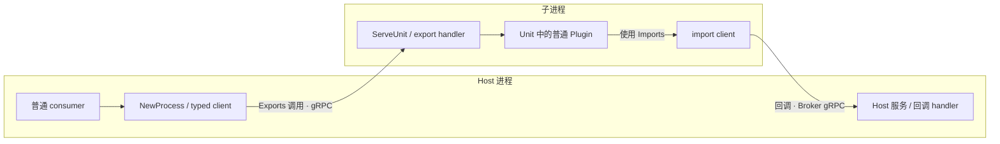

# 架构与生命周期

[English](architecture.md) | 中文 · [返回 README](../README.zh.md)

gordis-rpc 把一个 Gordis 装配放到子进程，通过显式 Binding 连接两侧服务。业务对象、Scope 和 Go 函数留在各自进程中，跨边界传递的是 DTO。

## 各层职责

| 层 | 负责 |
| --- | --- |
| 普通 Gordis Plugin | Spec/Activate、Get/Provide、业务配置与清理 |
| 领域适配 / Binding | DTO、序列化、typed client、方法 handler、领域贡献注册 |
| gordis-rpc | 程序配置声明、发现、严格解码与实例映射；Unit 装配、边界校验、Session、就绪与清理协调 |
| go-plugin / gRPC | 进程启动、基础握手、连接、Broker 和 RPC 传输 |

工具、模型和 prompt 的业务规则由各自适配层持有。运行对象是可信的本地程序，进程隔离不构成不可信代码沙箱。运行库不提供远程发现、鉴权、断线重连或强制终止 goroutine。

jsonschema-go fork 负责配置 Schema 生成、解析及输入校验；gordis-rpc 适配这些操作，公开 API 不暴露第三方类型。作者规则见[配置声明](concepts.zh.md#声明程序配置)。

## 启动：进程存在之后，还要等待业务 Ready

1. **声明**：Host 注册 `NewProcess(ProcessOptions)`；child 用 `ServeUnit` 声明 Identity 和 Unit。
2. **固定依赖**：激活时通过 Host Scope.Get 解析普通 Imports，通过 LocalImports 取得私有回调，先登记清理，再启动程序。StartupTimeout 从导入校验前开始。
3. **发现与校验**：Describe 返回身份、完整 Boundary 和 ConfigSchema；Host 对照 ChildBoundary 检查契约名、版本、方向及身份，编译本次 Schema，在安装回调和 Initialize 前校验程序配置。此时尚未构造或激活业务实例。
4. **初始化**：有 Imports 才安装 Broker 回调服务。Initialize 携带 Session 与程序配置。child 在 Unit 声明校验后独立校验输入，调用 New、严格解码和 Configure，将所有覆盖暂存到独立实例副本，全部成功后才通过 Gordis ChangeSet 准备、装配并等待本地实例 Ready，解析、验证和固定导出。
5. **发布与监视**：`NewProcess` 一次性构造并检查全部 export client，再将这些相同实例通过 Scope.Provide 发布。Attach 在远端 Ready 后运行可选 Accept，并安装受 Scope 管理的 Watch。

初始化、导出准备、发布或 Accept 失败时，返回错误前执行幂等回收；Gordis 回滚 Scope 暂存的服务。连接成功或 PID 存在都不代表业务 Ready。

Unit 声明校验（包括实例 ID 唯一性）在配置方法之前完成。每次初始化至多调用一次 New、Configure，失败不重试。child 先检查全部映射目标，再序列化任何映射值；序列化或取消失败会丢弃独立实例副本，业务实例不会激活。输入、Schema 和实例 JSON 按边界复制；映射后普通 Plugin 仍执行解码与 Validate。Schema/解码诊断不包含输入值，Configure 错误的内容由作者负责。

## 选择入口

`DescribeProgram(ctx, command, limits)` 真实启动并回收进程，返回身份、child 视角 Contracts 和 ConfigSchema；不安装回调，不执行初始化、配置方法或业务清理。

发现的成功、错误、取消路径均回收进程；无需 Scope，返回独立数据副本。Plugins、Instances 及内部配置目标不向 Host 传输。即使 Host 先前探测过同一命令，Attach 也始终获取并校验本次描述，包括 Schema。

普通服务使用 `NewProcess`，由库完成 Requires/Provides 和代理发布。只有需要领域贡献注册等适配逻辑时，才直接使用 `Attach(ctx, scope, options)` 与 Accept。

直接 Attach 的 Host Plugin 必须在 Requires 中声明普通 Imports。Attach 通过 Scope.Get 解析这些依赖，保障回调 provider 的生命周期。adapter 自己持有的激活期私有回调可以用 `BindLocalImport` 和 `AttachOptions.LocalImports` 注入；它们仍须匹配 ChildBoundary.Imports，不能绕过外部服务依赖。

Attach 不自动发布 Exports。Accept 中用 `session.PrepareExports()` 和 `PreparedClient(prepared, key)` 检查已准备的客户端，再通过 `prepared.Provide(scope)` 发布同一批对象，或用 `prepared.ProvideServices(scope, services...)` 发布显式子集。客户端也可保持私有，用于领域贡献注册。低层 `ExportClient(session, key)` 每次调用 factory，不发布服务；需要保持对象身份时使用 PreparedClient。详见[私有回调与导出发布](bindings.zh.md#领域-adapter-的私有回调与导出发布)。

## 调用与取消

每次 Attach 生成随机 Session ID，并绑定 Host 实例与 generation。Invoker 限定一个契约和一个 Session；ExportClient 只接受已声明且 Go 类型匹配的导出。

导出请求持有 Scope 的 Ready lease，即调用期间阻止相应服务完成释放。取消传给 handler，lease 等实际 handler 返回后才释放。server-stream 同步发送 chunk，库不建立生产队列；消费者提前停止会取消远端流。RPC 为每个 Session 的两端提供独立的出站 Pending 和入站 Handling 预算；领域层仍负责订阅、token 等领域资源限制。普通 unary 和 stream 共用 Business 额度；并发额度字段 0 表示不限，正数为上限，负数无效。应用按负载显式选择上限，有限额度超额立即拒绝。不限额度仍统计实际工作并等待停止排空。Host 与 Child 分别配置自己的 Limits。详见[即时准入](bindings.zh.md#即时准入)。

协议标识为 `gordis-rpc/1`，transport 握手版本为 1。控制消息与领域 DTO 以 JSON 经 protobuf BytesValue 传输，调用使用 gRPC unary/server-stream。修改协议时，Host 与子进程须同步重建。wire Go 类型与 RPC 路径是私有实现；生成 Binding 的数据格式另见 [Binding 文档](bindings.zh.md)。

## 停止与故障

正常停止依次执行：**Quiesce 关闭准入并发起 child Shutdown → Dispose 等待清理报告 → Host 回收进程 → 停止 Host 回调服务**。回调服务等待实际 handler 退出，使依赖 provider 在回调结束前仍存活。

Watch 将 child 节点失败或意外终止反馈给 Host。主连接丢失或父进程身份改变时，child 尝试清理，并在 OrphanGrace 内停止服务，让标准 main 返回；该检查也覆盖 Initialize 前的启动窗口。业务或回调不响应取消时，清理可能不完整。

`Session.Snapshot()` 与 `ProcessPlugin.Snapshot()` 返回独立的诊断副本：

| 字段 | 如何理解 |
| --- | --- |
| Ready | 远端曾就绪；正常回收后会清除，不能代替实时健康检查 |
| Nodes | 初始化成功时的节点快照，不是持续更新的节点状态 |
| Admission | 当前 Host 端各类别的出站 Pending 与入站 Handling 计数 |
| CallbackHandling | 实际尚未退出的 callback 数；入口开放时为零只表示空闲 |
| CallbacksClosed | callback 入口已关闭 |
| CallbacksDrained | callback 入口已关闭，且实际 handler 已全部退出 |
| CallbackTransportClosed | callback transport 关闭已完成 |
| Reaped | 进程已回收，不表示业务清理成功 |
| Cleanup | 查看 CleanupComplete、Forced 和 Errors，判断实际清理结果 |

ProcessPlugin 保留失败 Attach 的诊断；尚未 Attach 时返回零值。源码入口：[config.go](../config.go)、[program.go](../program.go)、[process.go](../process.go)、[session.go](../session.go)、[unit.go](../unit.go)、[server.go](../server.go)。
